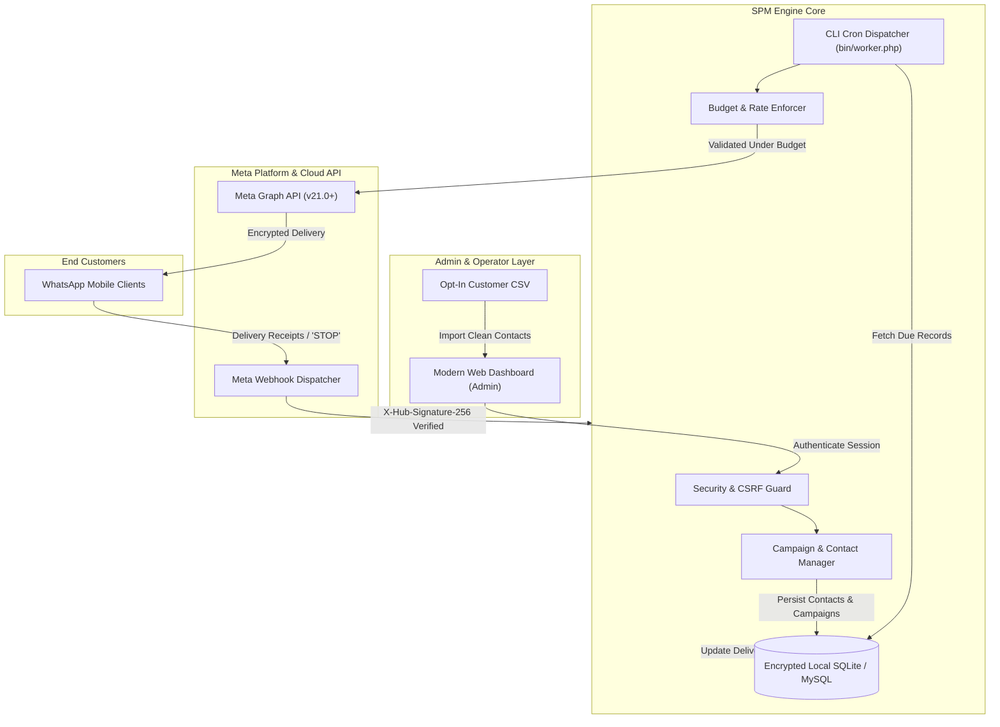

<div align="center">

# 📱 SPM WhatsApp Campaign Engine™
### Enterprise Meta Cloud API Automation & Marketing Dispatch Platform

[](LICENSE)
[](https://php.net)
[](https://developers.facebook.com/docs/whatsapp/cloud-api)
[](CONTRIBUTING.md)
[](https://www.spmanchester.com)

**Engineered with ❤️ by [SPManchester Private Limited](https://www.spmanchester.com)**

[Explore Features](#-key-features) • [Architecture](#-system-architecture) • [Quick Start](#-quick-start) • [Meta Setup](#-meta-cloud-api-configuration) • [Production Deployment](#-production-deployment) • [About the Author](#-about-spmanchester-private-limited)

---

</div>

## 📌 Executive Summary

**SPM WhatsApp Campaign Engine™** is a scalable, security-first WhatsApp campaign automation platform engineered for fashion houses, clothing retailers, and e-commerce enterprises. Powered by official **Meta WhatsApp Cloud API (Graph API v21.0+)**, it eliminates reliance on expensive third-party wrappers while guaranteeing regulatory compliance, recipient consent management, and automated budget safeguards.

Developed and maintained by **SPManchester Private Limited**, this platform provides enterprise marketing teams with complete control over broadcast schedules, spend guards, delivery analytics, and automated unsubscription processing.

---

## ⚡ Key Features

* **🛡️ Smart Budget & Spend Guardrails:** Pre-configured maximum expenditure caps prevent unexpected runaway Meta API billing charges.
* **⏱️ Anti-Spam & Token-Bucket Rate Limiting:** Enforces hourly and daily per-campaign quotas, pacing dispatches via cron workers to maintain Meta high-tier quality ratings.
* **📱 Automated Template Formatting:** Native integration with Meta approved marketing templates, supporting dynamic image headers and dynamic campaign URLs (`{{1}}`).
* **🛑 Instant Opt-Out & Regulatory Compliance:** Built-in webhook listener monitors inbound `STOP`, `UNSUBSCRIBE`, or `OPT OUT` keywords, instantly blacklisting numbers to respect customer privacy and regulatory mandates.
* **🔒 Enterprise Security Posture:**
  * Meta `X-Hub-Signature-256` SHA-256 HMAC payload verification.
  * CSRF token protection and session hardening (`Strict` SameSite, HttpOnly, Secure).
  * Storage and configuration completely decoupled from the web root.
* **📊 Two-Way Delivery Telemetry:** Real-time webhook tracking of message statuses (`sent`, `delivered`, `read`, `failed`).
* **📦 Frictionless CSV Ingestion:** E.164 phone normalization (supporting Pakistani mobile formats, international dial codes, and duplicate de-duplication).

---

## 🏗️ System Architecture



---

## 🛠️ Technology Stack

| Layer | Component | Description |
| :--- | :--- | :--- |
| **Runtime** | PHP 8.2+ | Modern, strict-typed backend engine |
| **API Integration** | Meta WhatsApp Cloud API | Official Cloud API direct integration (Zero third-party vendor lock-in) |
| **Database** | SQLite 3 / MySQL | High-performance transactional storage with WAL mode |
| **Containerization**| Docker & Docker Compose | Multi-container setup with Nginx and PHP-FPM |
| **Security** | OpenSSL / Libsodium | HMAC SHA-256 webhook validation and password hashing |
| **Background Processing**| POSIX CLI / Cron | Non-blocking scheduled worker execution with file lock control |

---

## 🚀 Quick Start

### 1. Prerequisites
* **PHP 8.2+** with `pdo_sqlite`, `curl`, and `openssl` extensions enabled.
* **Composer 2.x** installed.
* A verified **Meta Business Manager** account with an active WhatsApp Business App.

### 2. Clone & Setup
```bash
# Clone the repository
git clone https://github.com/your-username/WhatsApp-Clothing-Campaign-Manager.git
cd whatsapp-campaign-engine

# Copy configuration template
cp .env.example .env

# Install dependencies (if using Composer autoloader)
composer install --no-dev --optimize-autoloader
```

### 3. Generate Secure Admin Hash
Generate a secure password hash for your admin panel:
```bash
php -r 'echo password_hash("YourSecurePassword123!", PASSWORD_DEFAULT) . PHP_EOL;'
```
Paste this hash into your `.env` or `config/app.php` under `ADMIN_PASSWORD_HASH`.

### 4. Initialize Database
Run the CLI schema migration script:
```bash
php bin/init.php
```

### 5. Start Local Testing Server
```bash
php -S 127.0.0.1:8000 -t public
```
Visit `http://127.0.0.1:8000` to access the SPM Campaign Manager.

---

## ⚙️ Meta Cloud API Configuration

1. **Meta Developer Portal:**
   * Navigate to [Meta for Developers](https://developers.facebook.com/apps/) and create a Business App.
   * Add the **WhatsApp** product.
   * Retrieve your **Phone Number ID**, **WhatsApp Business Account (WABA) ID**, and **App Secret**.
2. **Access Token:**
   * Generate a permanent **System User Access Token** with the `whatsapp_business_messaging` permission.
3. **Register Webhook:**
   * Set Callback URL: `https://your-domain.com/webhook.php`
   * Enter your designated `VERIFY_TOKEN`.
   * Subscribe to the `messages` webhook field.

---

## ⏱️ Scheduling Dispatch (Cron Automation)

To schedule campaign dispatching safely without blocking the web interface, set up a server-side cron job running under the PHP CLI:

```bash
# Run every 5 minutes
*/5 * * * * /usr/bin/php /var/www/whatsapp-campaign-engine/bin/worker.php >> /var/www/whatsapp-campaign-engine/storage/logs/cron.log 2>&1
```

*The worker incorporates a non-blocking flock (`worker.lock`) to ensure parallel runs never cause duplicate messaging.*

---

## 🗺️ Roadmap & Planned Enhancements

- [x] Meta Cloud API v21.0/v23.0 direct integration
- [x] Automated STOP / Opt-out compliance trigger
- [x] Daily cap and spend protection guardrails
- [ ] Multi-product interactive WhatsApp Catalog integration
- [ ] Multi-lingual auto-responder for customer queries
- [ ] MySQL / PostgreSQL enterprise database connector adapter
- [ ] Multi-agent support inbox module

---

## 🤝 Contributing

We welcome community contributions, bug reports, and pull requests! Please read our [CONTRIBUTING.md](CONTRIBUTING.md) and adhere to our [CODE_OF_CONDUCT.md](CODE_OF_CONDUCT.md).

For vulnerability notifications, refer to our [SECURITY.md](SECURITY.md).

---

## 🏢 About SPManchester Private Limited

**SPManchester Private Limited** is an international technology, software engineering, and digital transformation consultancy. We architect enterprise-grade software, AI workflows, and omni-channel cloud automation solutions that empower brands across the globe.

* **Corporate Website:** [https://www.spmanchester.com](https://www.spmanchester.com)
* **Lead Project Architect:** **Sayed Mudassar Akbar**
* **Technical Inquiries & Enterprise Support:** [info@spmanchester.com](mailto:info@spmanchester.com)
* **Office & Headquarters:** SPManchester Private Limited

*Need custom WhatsApp automation, ERP integrations, or high-throughput cloud infrastructure? [Contact our team today](https://www.spmanchester.com).*

---

## 📄 License & Attribution

Copyright © 2026 **SPManchester Private Limited**. Distributed under the **MIT License**.  
See the [LICENSE](LICENSE) file for complete terms.
