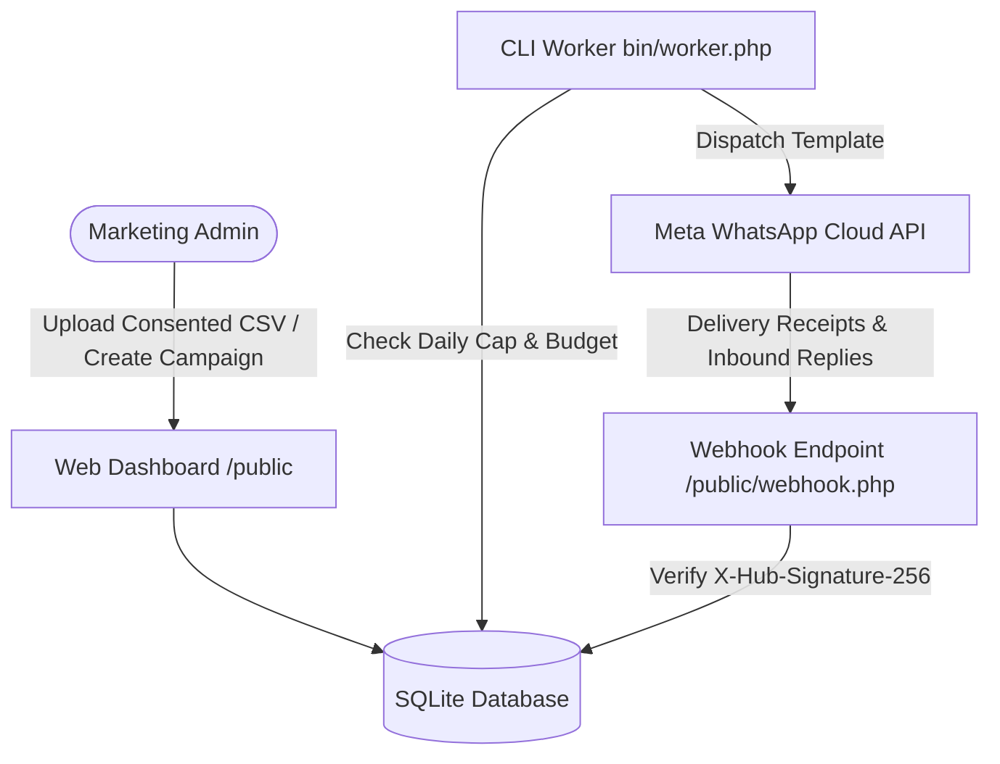

# SPM WhatsApp Campaign Engine

An enterprise-ready Meta WhatsApp Cloud API marketing automation and dispatch platform tailored for e-commerce, clothing brands, and retail businesses.

Built with care by **SPManchester Private Limited** ([www.spmanchester.com](https://www.spmanchester.com)).  
**Lead Architect:** Sayed Mudassar Akbar ([info@spmanchester.com](mailto:info@spmanchester.com))

---

## Overview

SPM WhatsApp Campaign Engine connects your retail store directly to Meta's official WhatsApp Business Cloud API. It provides a secure, audited pipeline to dispatch template-based marketing promotions, control campaign spending, enforce daily caps, and process opt-outs automatically via webhooks.

### Key Highlights
- **Direct Meta Cloud API (v21.0+)**: No middleman or third-party message markup.
- **Spend & Budget Guardrails**: Automated execution stops when estimated campaign budgets or daily ceilings are reached.
- **Automated Opt-Out Compliance**: Immediate suppression when customers reply with keywords like `STOP` or `UNSUBSCRIBE`.
- **E.164 Contact Normalization**: Automatic formatting and duplicate exclusion for international numbers.
- **Enterprise Decoupled Architecture**: Web root isolation, CSRF protection, and secure signature verification for all incoming Meta webhooks.

---

## Architecture Flow



---

## Project Structure

```text
whatsapp_clothing_campaign/
├── bin/
│   ├── init.php                # CLI Database schema initializer
│   └── worker.php              # Scheduled dispatch worker
├── config/
│   └── app.php                 # Central configuration
├── public/
│   ├── .htaccess               # Apache hardening
│   ├── index.php               # Admin web control panel
│   └── webhook.php             # Meta Cloud API webhook listener
├── src/
│   ├── Client/
│   │   └── WhatsAppClient.php  # Meta Cloud API HTTP integration
│   ├── Database/
│   │   └── Connection.php      # PDO database manager
│   ├── Security/
│   │   └── Guard.php           # CSRF, phone normalization & escaping
│   └── Services/
│       └── WebhookHandler.php  # Webhook signature & message parser
├── storage/
│   ├── db/                     # SQLite database storage
│   └── logs/                   # Application and cron logs
├── .env.example                # Sample environment configuration
├── docker-compose.yml          # Container configuration
└── composer.json               # Package definition
```

---

## Quick Setup Guide

### 1. Requirements
- PHP 8.1 or higher (with `pdo_sqlite`, `curl`, and `openssl` extensions).
- Meta Developer account with an approved WhatsApp Business Application.

### 2. Configuration
Copy `.env.example` to `.env` or set environment variables:
```bash
cp .env.example .env
```

Generate a secure password hash for your dashboard login:
```bash
php -r 'echo password_hash("YourSecurePasswordHere", PASSWORD_DEFAULT);'
```
Paste this hash into your environment under `ADMIN_PASSWORD_HASH`.

### 3. Initialize Database
Run the command-line schema creator:
```bash
php bin/init.php
```

### 4. Run Locally
```bash
php -S 127.0.0.1:8000 -t public
```
Visit `http://127.0.0.1:8000` to access the dashboard.

### 5. Configure Cron Worker
Add a scheduled job (e.g. every 5 minutes) on your server:
```bash
*/5 * * * * php /path/to/whatsapp_clothing_campaign/bin/worker.php >> /path/to/whatsapp_clothing_campaign/storage/logs/cron.log 2>&1
```

---

## Webhook Verification
In the Meta App Dashboard under WhatsApp Configuration:
- **Callback URL:** `https://your-domain.com/webhook.php`
- **Verify Token:** The value configured in `META_WEBHOOK_VERIFY_TOKEN`.
- **Subscribed Fields:** `messages`.

---

## About SPManchester Private Limited

**SPManchester Private Limited** delivers modern digital transformation, enterprise software architecture, and marketing automation solutions worldwide.

- **Website:** [https://www.spmanchester.com](https://www.spmanchester.com)
- **Lead Architect:** Sayed Mudassar Akbar
- **Contact & Partnerships:** [info@spmanchester.com](mailto:info@spmanchester.com)

---

## License

This project is licensed under the terms of the open source license included in the [LICENSE](LICENSE) file.  
Copyright (c) 2026 **SPManchester Private Limited**.
